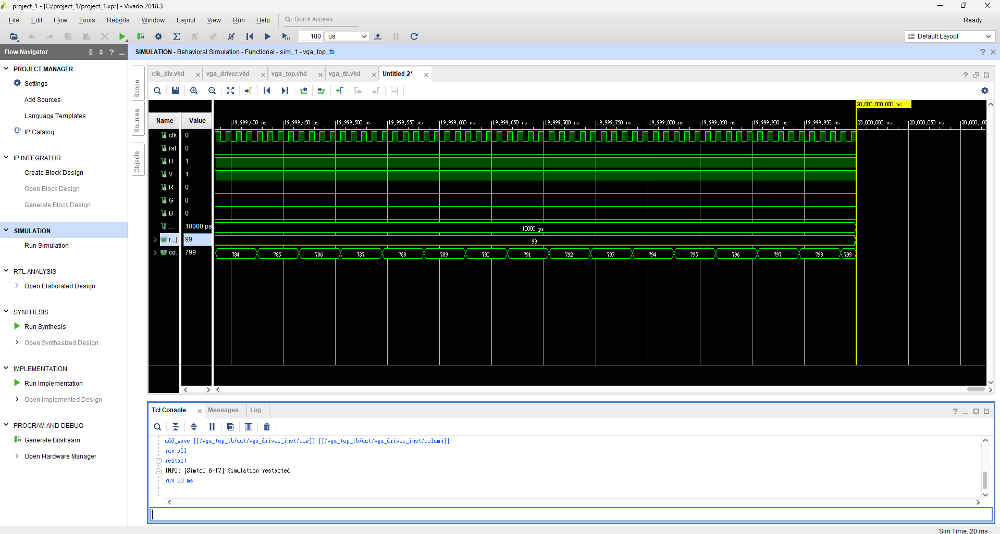
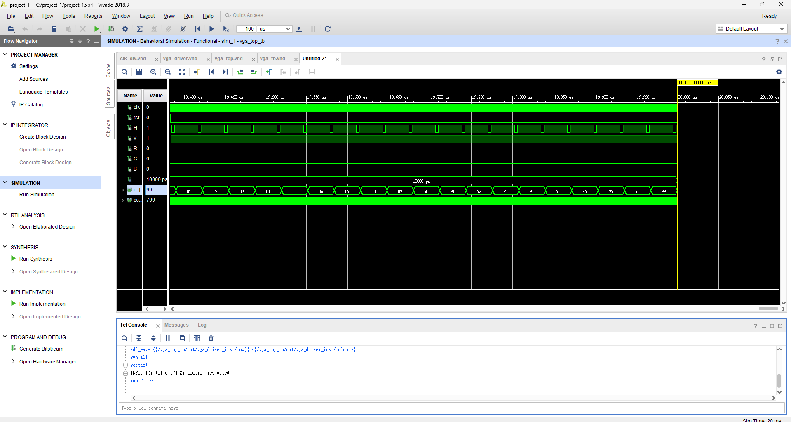
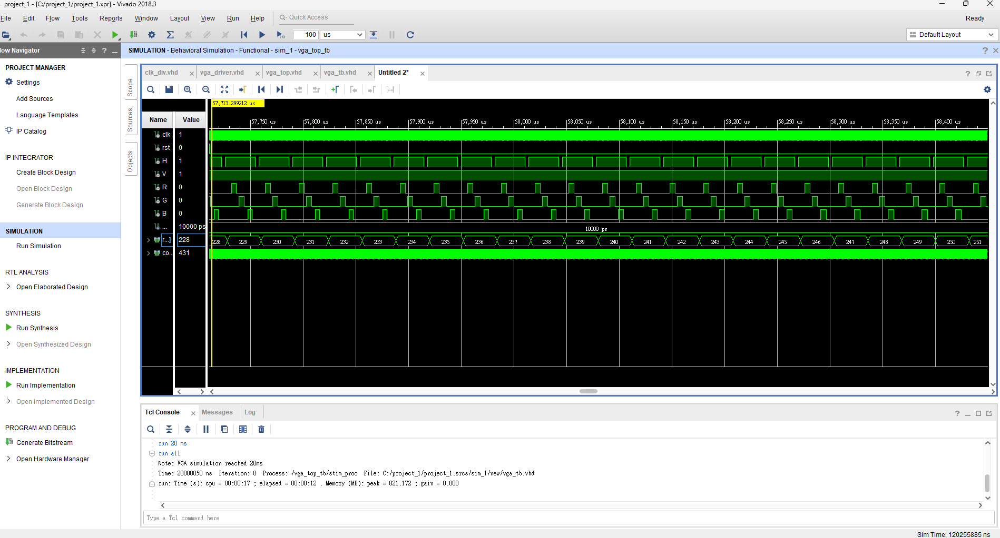

# 11/18 VGA 圖形顯示系統實作

本次使用 Vivado 2018.3 與 VHDL，
設計 VGA 640×480 圖形顯示系統。

## 專案相關檔案

📁 [點擊查看 VGA 程式碼與波形圖片](1118/)

## VHDL 原始程式

- [clk_div.vhd：時脈分頻](1118/clk_div.vhd)
- [vga_driver.vhd：VGA 同步訊號](1118/vga_driver.vhd)
- [vga_top.vhd：幾何圖形產生](1118/vga_top.vhd)
- [vga_top_tb.vhd：模擬測試](1118/vga_top_tb.vhd)

## 模擬波形

### HSYNC 與 RGB 訊號

### Row / Column 計數器

### 第 240 列的模擬結果

