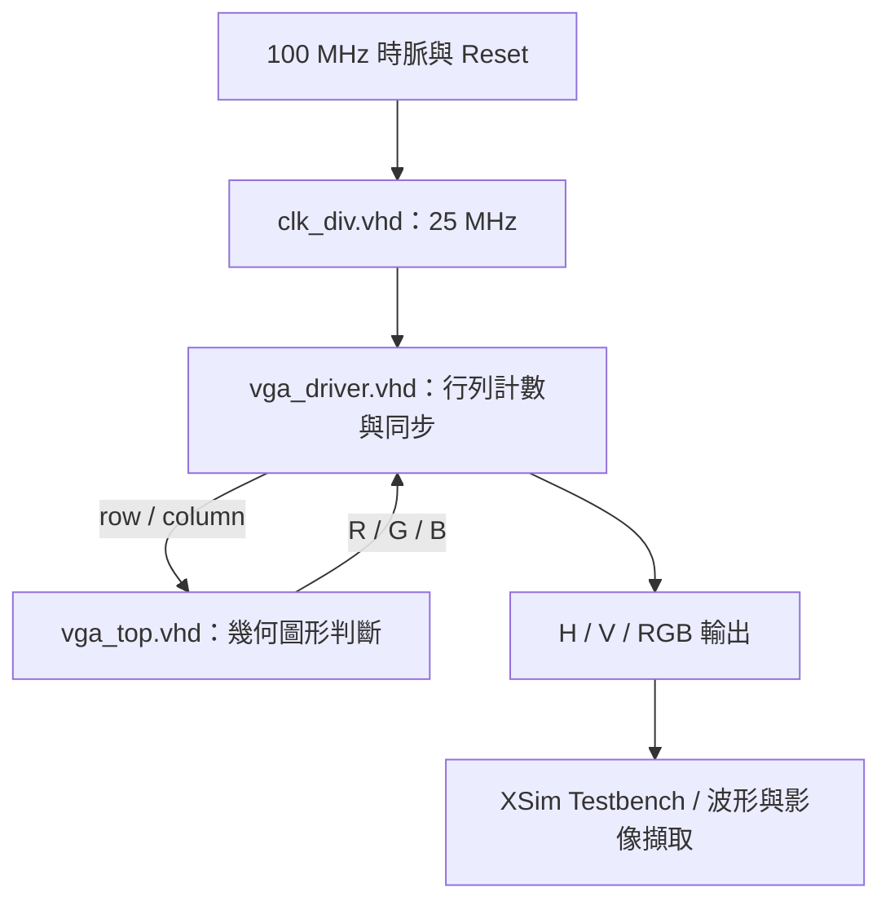

# FPGA VGA 640×480 圖形顯示實作（Vivado 2018.3）

> **專題狀態：已進行 XSim 行為模擬；尚未使用 ZC702 實體板與 HDMI 螢幕驗證。**
>
> 本 Repository 記錄電子工程課程 VGA 的設計原理、VHDL 程式、波形觀察、模擬方法與後續 HDMI 規劃。

## 1. 專題目標

本專題使用 **VHDL** 在 **Vivado 2018.3** 設計 **640 × 480** 類 VGA 掃描時序，包含水平同步（HSYNC）、垂直同步（VSYNC）、像素座標計數器，以及以座標方程式繪製**紅色圓形、綠色正方形與藍色三角形**。先以 **XSim** 驗證，不需 FPGA 硬體即可觀察波形。

- 設計平台：Xilinx Vivado 2018.3 / XSim
- 預計開發板：Xilinx ZC702（Zynq-7000）
- 系統時脈：100 MHz（Testbench 模擬輸入）
- 像素時脈：25 MHz（100 MHz ÷ 4）
- 顯示有效區：640 × 480
- 同步極性：HSYNC、VSYNC 皆為低有效
- RGB 訊號：每色 1 bit，共 3 bit（8 種組合）

## 2. 系統架構



`vga_top.vhd` 是頂層模組，內部實例化 `clk_div` 和 `vga_driver`。這個設計是 VGA **邏輯驗證**，並非已完成的 ZC702 HDMI 發射系統。

## 3. VGA 工作原理

VGA 掃描以像素時脈逐點輸出。**水平計數器**從 0 到 799，完成一列後歸零並讓**垂直計數器**加一；垂直計數器從 0 到 524 後重新開始。

### 3.1 時序參數（依本專題原始 `vga_driver.vhd`）

| 參數 | 水平（pixel clocks） | 垂直（lines） |
|---|---:|---:|
| 有效顯示 | 640 | 480 |
| 空白區段 E / S | 22 | 11 |
| Sync pulse B / P | 93 | 2 |
| 空白區段 C / Q | 45 | 32 |
| 總數 | **800** | **525** |

> 表格依照程式中的**實際掃描順序**排列：有效區 → E/S → Sync → C/Q。原程式對 front/back porch 的註解和實際順序可能不同；這裡保留原始數值，避免把 93/45/22 誤寫成標準 96/48/16。這組設定並非最常見的 VESA 640×480 標準 porch 配置。

計算：

```text
100 MHz ÷ 4 = 25 MHz
800 × 40 ns = 32 μs / line
525 × 32 μs = 16.8 ms / frame
25,000,000 ÷ (800 × 525) ≈ 59.52 Hz
水平同步低電位：93 × 40 ns = 3.72 μs
垂直同步低電位：2 × 32 μs = 64 μs
```

### 3.2 同步訊號

- **HSYNC (H)**：一列內計數器落在 `662 ≤ column < 755` 時輸出 0，否則輸出 1。
- **VSYNC (V)**：一幀內計數器落在 `491 ≤ row < 493` 時輸出 0，否則輸出 1。
- **row / column**：分別代表垂直（Y）與水平（X）掃描座標。

## 4. 幾何圖形與 RGB 顏色

| 圖形 | 座標條件 | RGB (R,G,B) |
|---|---|---|
| 紅色圓形 | `(x-160)²+(y-240)² ≤ 60²` | `100` |
| 綠色正方形 | `280 ≤ x ≤ 400` 且 `180 ≤ y ≤ 300` | `010` |
| 藍色三角形 | `180 ≤ y ≤ 300` 且 `540-(y-180) ≤ x ≤ 540+(y-180)` | `001` |
| 黑色背景 | 其餘位置 | `000` |

三角形右邊界在 y=300 時為 x=660，**超過有效顯示 x=639，因此右下角被裁切**。這是課堂程式原始邏輯，不是模擬器錯誤。判斷優先順序為：圓形 → 正方形 → 三角形 → 背景。

以 `row = 240` 為例，掃描時預期依序遇到紅、綠、藍色區域，可在波形中對照 `column` 與 RGB 訊號。

## 5. 檔案結構

```text
ZC702_VGA_GitHub_Report/
├── README.md
├── .gitignore
├── rtl/
│   ├── clk_div.vhd         # 100 MHz / 4 → 25 MHz
│   ├── vga_driver.vhd      # 同步訊號與 row/column
│   └── vga_top.vhd         # 圓形、正方形、三角形
├── sim/
│   ├── vga_top_tb.vhd      # 基本波形模擬
│   ├── vga_image_tb.vhd    # 嘗試將模擬輸出擷取為 PPM
│   └── ppm_to_png.py       # PPM → PNG 工具
├── images/
│   ├── waveform_hsync_rgb.png
│   ├── waveform_row.png
│   └── waveform_row_240.png
└── docs/
    └── HDMI_PLAN.md       # 後續 HDMI 整合規劃
```

`rtl/` 檔案保留課堂原始運算邏輯；`clk_div.vhd` 補齊輸出指派與架構結尾。程式使用舊式 `STD_LOGIC_UNSIGNED/ARITH`，後續可遷移至 IEEE `numeric_std`。

## 6. Vivado 2018.3 執行方法

1. `Create Project` → RTL Project，使用原先的 Vivado 2018.3 工程（或建立新工程）。
2. `Add Sources → Add or Create Design Sources`：加入 `rtl/clk_div.vhd`、`rtl/vga_driver.vhd`、`rtl/vga_top.vhd`。
3. `Add Sources → Add or Create Simulation Sources`：加入 `sim/vga_top_tb.vhd`。
4. 在 **Simulation Sources** 將 `vga_top_tb` 設成 Top；`Run Simulation → Run Behavioral Simulation`。
5. Tcl Console 執行：

   ```tcl
   restart
   run 20 ms
   ```

6. 在 Scope 選 `uut`，將 `row`、`column` 加到 Waveform，並右鍵設定 `Radix → Unsigned Decimal`。
7. 放大約 100 μs 觀察 HSYNC；放大約 20 ms 觀察 VSYNC；選定 `row=240` 的一列觀察 RGB 脈衝與 column 的關係。

**注意：** `vga_top_tb.vhd` 的時脈會持續運作；使用 `run 20 ms` 控制觀察時間。

### 額外：畫面擷取（選用）

可另將 `sim/vga_image_tb.vhd` 設為 Simulation Top，再執行約 `35 ms`，使模擬嘗試產生 `vga_output.ppm`（P3 格式）。這是**輔助驗證工具，尚未在使用者的 Vivado 環境確認擷取圖片結果**。若產生的圖片有偏移，應檢查 VSYNC 對齊與取樣時序，不應直接當作硬體成功證據。可使用 `sim/ppm_to_png.py` 轉 PNG。

## 7. XSim 波形紀錄

### 7.1 HSYNC 與 RGB 輸出


可見 H 出現週期性的低電位脈衝，以及 R/G/B 依掃描座標出現高電位脈衝；截圖只能證明**有訊號切換**，尚未逐像素自動比對整個畫面。

### 7.2 row / column 計數器


在模擬時間約 20 ms 時，row 約 99、column 約 799。這與 16.8 ms/幀、32 μs/列的計數模型相符。

### 7.3 row 240 附近的 RGB


放大可觀察 row 由 228 逐步增加到 251，三個色彩訊號隨水平掃描有規律跳變。要嚴格確認每一段圖形的 X 範圍，仍須放大單列並比對 column。

## 8. 實驗結果與限制

**已觀察到：** XSim 中時脈運作、HSYNC 週期性低電位、垂直計數器逐列前進、R/G/B 有脈衝輸出，與目前 VHDL 設計預期相符。

**尚未完成：** 自動化像素比對、PPM 擷取結果確認、綜合/時序收斂檢查，以及 ZC702 實體 HDMI 輸出測試。

> **重要區別：** ZC702 板上 HDMI 經 ADV7511 晶片輸出。`vga_top` 的單 bit R/G/B 與 H/V **無法直接用 XDC 連到 HDMI**。需要 HDMI 專用頂層、16-bit 影像資料、DE、時脈及 PS I²C 初始化。詳見 [HDMI 後續規劃](docs/HDMI_PLAN.md)。

## 9. 心得與後續規劃

這次實作讓我了解 VGA 畫面的產生方式：畫面並非一次輸出，而是由像素時脈控制水平、垂直計數器逐點掃描，再依座標決定 RGB 顏色。起初在 XSim 中只能看到數位訊號的高低變化，後來加入 row、column 並調整時間尺度，逐步能將波形與圖形位置對應。這也讓我理解 HDL 寫完並不代表完成實作，還需要驗證同步、座標與資料的時序。未來希望加入 HDMI 介面、色彩資料轉換與 ADV7511 初始化，最後在 ZC702 上實際顯示。

## 10. 參考資料

- 課程黑板筆記（VGA 同步、Front/Back Porch、幾何圖形方程式）
- AMD/Xilinx Vivado Design Suite 與 XSim 文件
- AMD/Xilinx ZC702 Evaluation Board User Guide (UG850)
- Analog Devices ADV7511 Programming Guide

---

*本專案為學習及課程紀錄；文中的計算與預期圖形以所附 VHDL 程式為準。*
